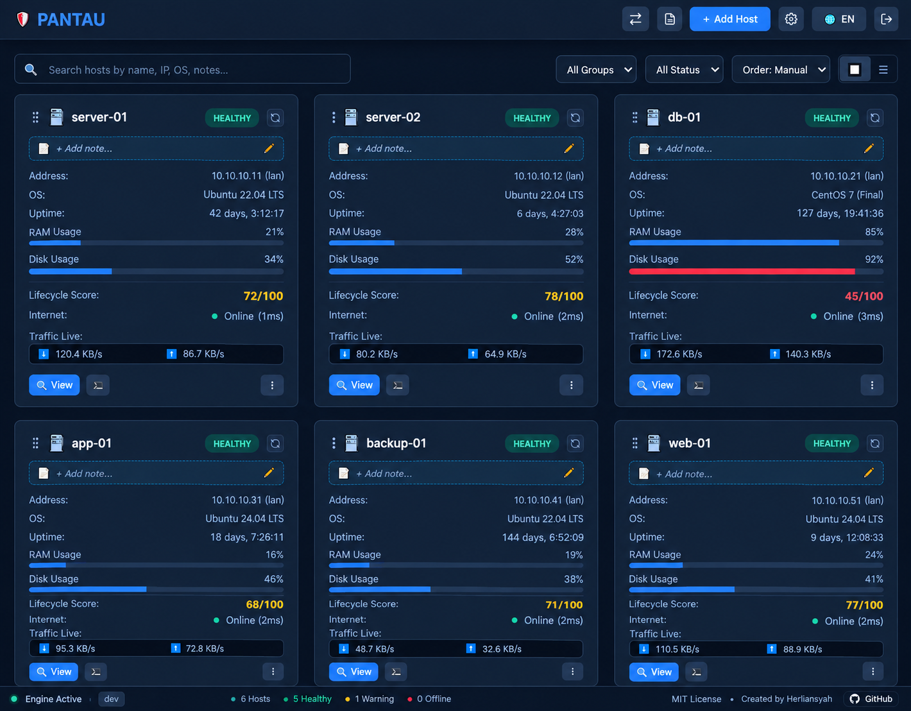

<p align="center">
  <a href="#readme">
    
  </a>
</p>

<h1 align="center">Pantau</h1>

<p align="center">
  Agentless Linux server monitoring and lightweight remote operations in a single binary.
</p>

<p align="center">
  <a href="README.md"><b>English</b></a> •
  <a href="README.id.md"><b>Bahasa Indonesia</b></a> •
  <a href="docs/user-guide.md"><b>Documentation</b></a> •
  <a href="https://github.com/herliansyah/pantau/releases"><b>Releases</b></a>
</p>

<p align="center">
  <a href="https://github.com/herliansyah/pantau/releases"></a>
  
  
  <a href="LICENSE"></a>
</p>

<p align="center">
  
</p>

---

## Why Pantau?

Most infrastructure monitoring tools require installing, configuring, and maintaining background agents (like Prometheus Node Exporter, Datadog Agent, or Zabbix Agent) across every managed machine. For small to mid-sized fleets, airgapped intranets, or environments with legacy operating systems, this introduces significant maintenance overhead and security surface.

**Pantau takes a different path:**
- **Zero remote agents**: Operates exclusively over standard OpenSSH (`port 22`) using POSIX standard commands. Target servers require zero daemon installations, zero open telemetry ports, and zero background resource footprint.
- **Single self-contained binary**: Written in Go with an embedded SQLite database and embedded zero-npm web interface. Runs anywhere with zero external dependencies.
- **Operations in one place**: Combines health metrics, drift detection against desired state baselines, interactive multi-tab terminals, secure file management, and zero-disk cross-host file streaming inside a single web dashboard.

---

## Architecture

```
                    +------------------------------------+
                    |         Web Browser Client         |
                    |   (SPA, xterm.js, CodeMirror, SSE) |
                    +-----------------+------------------+
                                      | HTTP / WebSocket
                                      v
+---------------------------------------------------------------------------------+
|                            PANTAU CONTROL PLANE (Go)                            |
|                                                                                 |
|  +--------------------+  +---------------------+  +--------------------------+  |
|  |  Inspection Loop   |  | Drift Engine        |  | Cross-Host Stream        |  |
|  |  (SSH POSIX probe) |  | (Baseline vs State) |  | (Memory pipe, zero disk) |  |
|  +---------+----------+  +----------+----------+  +------------+-------------+  |
|            |                        |                          |                |
|            +------------------------+--------------------------+                |
|                                     |                                           |
|                       +-------------v-------------+                             |
|                       |   Embedded SQLite (WAL)   |                             |
|                       | Encrypted Snapshots (AES) |                             |
|                       +-------------+-------------+                             |
+-------------------------------------|-------------------------------------------+
                                      | Native SSH (Port 22)
                 +--------------------+--------------------+
                 v                                         v
+---------------------------------+       +---------------------------------+
|       Remote Linux Host         |       |      Remote Windows Host        |
| (Debian, Ubuntu, RHEL, Alpine)  |       | (Server 2019/22/25, Win 10/11)  |
| - Standard POSIX tools (ps, df) |       | - Native OpenSSH & PowerShell   |
| - Docker Engine / systemd       |       | - Services, Tasks, Disks, Ports |
| - No agents / daemons installed |       | - No agents / daemons installed |
+---------------------------------+       +---------------------------------+
```

---

## Core Capabilities

### 1. Fleet Health & Real-time Metrics
Pantau inspects remote Linux and Windows hosts via standard SSH connections using agentless non-interactive POSIX commands (`/proc`, `ps`, `df`, `ss`) and Base64-encoded UTF-16LE PowerShell scripts.
- **Resource saturation**: Tracks CPU load, memory utilization, swap usage, disk partitions (including Windows `C:` drive), and `/proc/diskstats` I/O rates without requiring `iostat`.
- **Process and network telemetry**: Identifies top CPU and memory-consuming processes, open listening ports, inbound active sockets, and failed SSH authentication attempts.
- **Package and lifecycle audit**: Catalogs installed software across Debian (`dpkg`), RHEL (`rpm`), Alpine (`apk`), and Arch (`pacman`), highlighting dormant services and calculating OS End-of-Life (EOL) timelines for Linux distributions, Windows 10, and Windows Server.
- **Time-series metrics & application probing**: Embedded SQLite storage for historical metrics with configurable retention (default 7 days) and hourly auto-pruning. Interactive multi-chart visualization powered by lightweight vendored uPlot (1h/6h/24h/7d/30d ranges with automatic SQL downsampling), mini-sparklines on host cards, and built-in probe presets for Linux (Nginx, MySQL, PHP-FPM, Redis, PostgreSQL) and Windows (IIS Web Service, MSSQL Server via CIM).
- **Fleet navigation & notes**: Rapid Host Switcher (`[` and `]` keyboard shortcuts or dropdown) inside the Host Details modal, 1-click metrics shortcut button on host cards and table rows, and default rendered Markdown preview for host and global notes.
- Learn more in the [Inspection and Metrics Guide](docs/user-guide.md#4-phase-3-observability-drift-triage--incident-response).

### 2. Agentless Storage Triage & Runaway Detection
Diagnose impending disk saturation across Linux and Windows targets without agents, periodic polling, or heavy background scanners.
- **On-demand triage probes**: Single-click forensic inspection bounded to 20–40 seconds, protected by a concurrency guard and load-aware throttling.
- **Tiered space hog discovery**: Breakdowns of mount point and drive consumption, top directory space hogs (level-1 `du` on Linux; high-speed zero-copy `robocopy /L` on Windows), top large files (>15MB), and runaway files modified within the last hour (excluding active DBMS engines and binary archives).
- **Ghost file detection**: Identifies deleted files held open by processes consuming unlinked disk space via `lsof` and `/proc/*/fd` inspection (`stat -L`) on Linux, offering one-click graceful service reloads.
- **Safe reclaim & log truncation**: Curated reclaim catalogs for Linux (systemd journal, package caches, rotated logs, coredumps, Docker prune) and Windows (Windows Update download cache, temp files, WER/crash dumps, Recycle Bin, old IIS logs, Docker), alongside in-place zero-byte log truncation (`truncate -s 0` on Linux, `Clear-Content` on Windows) guarded against path traversal and system directories.
- Learn more in the [Storage Triage Guide](docs/user-guide.md#agentless-storage-triage-runaway-detection--safe-reclaim).

### 3. Desired State Baselines & Incident Diagnostics
Establish expected operational baselines for containers, core services, disk thresholds, scheduled tasks, and backup timestamps.
- **Automated drift detection**: Detects when containers stop, systemd or Windows services fail, scheduled tasks or cron jobs vanish, or disk usage exceeds configured warning levels.
- **Root cause crash capture**: When a tracked service or container fails, Pantau automatically extracts the exit code, OOM-killed status flags, and the trailing lines from `journalctl`, `docker logs`, or Windows Event logs.
- Learn more in the [Desired State & Drift Guide](docs/user-guide.md#3-phase-2-desired-state-baselines--system-guardrails).

### 4. Integrated Web Terminal & Remote Operations
Manage target servers directly from the browser without context-switching to external terminal applications.
- **Multi-tab PTY terminal**: Browser-based interactive shell powered by `xterm.js` and WebSockets, supporting split-pane view (`Alt+\`), dynamic resizing, custom presets, and drive-aware path navigation (`C:/`, `D:/`) on Windows targets.
- **SFTP file editor & bookmarks**: Browse remote file trees, pin critical log or configuration paths, and edit scripts with syntax highlighting and Windows path normalization.
- **Remote web port tunneling**: Agentless HTTP/WebSocket reverse proxy over SSH `direct-tcpip` channels, allowing you to access private services (`localhost:port`) on remote servers without opening firewall ports.
- **Native OS terminal bridge**: Launch your local desktop terminal (Windows Terminal, GNOME Terminal, iTerm2, Alacritty) into any remote host with one click via ephemeral in-memory SSH keys and drive navigation.
- Learn more in the [Terminal and Remote Operations Guide](docs/user-guide.md#interactive-diagnostics-via-terminal-dock--terminal-presets).

### 5. Zero-Disk Streaming & Encrypted Backup
Safely transfer data between servers and safeguard your configuration cluster.
- **Piped cross-host transfer**: Stream files and directories directly between remote Linux servers through memory pipes (`tar` stream), bypassing Pantau's local storage entirely, with optional end-to-end SHA-256 verification.
- **Encrypted cluster snapshots**: Export host configurations, baselines, and SSH keys into portable encrypted snapshot archives secured with Argon2id and AES-256-GCM.
- **Automated disaster recovery**: Schedule periodic encrypted snapshot backups to private GitHub repositories for automated offsite recovery.
- Learn more in the [Cross-Host Transfer Guide](docs/user-guide.md#cross-host-transfer-zero-disk-memory-pipes).

### 6. Airgapped-First Architecture
Engineered from the ground up for strict security postures, private VPCs, and disconnected intranets.
- **Zero runtime dependencies**: Pure Go binary with embedded SQLite running in Write-Ahead Logging (WAL) mode.
- **Self-contained frontend**: All web assets, fonts, icons, and client scripts (`xterm.js`, `CodeMirror`) are embedded directly via `go:embed` with zero CDN calls.
- **Local security**: Multi-factor authentication via standard RFC 6238 TOTP with entirely client-side QR generation and emergency offline recovery codes.
- **Semi-automatic updates**: In-app release checking with SHA-256 integrity checks, pre-flight binary verification, and atomic in-place binary swapping.

### 7. Zero-Agent Windows Target Observability
Comprehensive management and observability for Windows Server (2019/2022/2025) and Windows 10/11 via native OpenSSH Server.
- **Zero-agent architecture**: Eliminates heavy remote daemons and complex WinRM/WMI firewall configurations by utilizing native OpenSSH (`sshd`) and UTF-16LE Base64-encoded PowerShell scripts.
- **Automated key provisioning**: Automatic placement of SSH public keys into user profiles (`%USERPROFILE%\.ssh\authorized_keys`) or Administrator paths (`%ProgramData%\ssh\administrators_authorized_keys`) with universal SIDs (`*S-1-5-18`, `*S-1-5-32-544`) and strict ACL inheritance via `icacls`.
- **Native telemetry & desired state**: Monitors CPU, RAM, disk partitions, network I/O, open ports, and evaluates services (`Get-Service`), scheduled tasks (`Get-ScheduledTask`), processes, and IIS/MSSQL application metrics.
- Learn more in the [Windows Target Architecture Record](docs/adr/0040-agentless-windows-target-observability.md).

---

## Quick Start

### Option 1: Standalone Binary (Recommended)

Download the pre-compiled binary for your architecture from [GitHub Releases](https://github.com/herliansyah/pantau/releases):

```bash
# Make binary executable
chmod +x pantau

# Start Pantau on port 8080
./pantau -port 8080 -db data/pantau.db
```

Open `http://localhost:8080` in your browser.  
Default password: `admin` *(prompted to update immediately upon first login)*.

### Option 2: Docker Compose

```yaml
services:
  pantau:
    image: ghcr.io/herliansyah/pantau:latest
    container_name: pantau
    restart: unless-stopped
    ports:
      - "8080:8080"
    volumes:
      - pantau-data:/data
    environment:
      - PANTAU_PORT=8080
      - PANTAU_DB=/data/pantau.db

volumes:
  pantau-data:
```

```bash
docker compose up -d
```

### Option 3: Systemd Service (Linux Server)

Create `/etc/systemd/system/pantau.service`:

```ini
[Unit]
Description=Pantau Server Monitoring & Management
After=network.target

[Service]
Type=simple
User=root
WorkingDirectory=/opt/pantau
ExecStart=/opt/pantau/pantau -port 8080 -db /opt/pantau/data/pantau.db
Restart=always
RestartSec=5
LimitNOFILE=65535

[Install]
WantedBy=multi-user.target
```

```bash
systemctl daemon-reload
systemctl enable --now pantau
```

---

## Configuration Reference

Pantau accepts configuration via CLI flags or equivalent environment variables:

| Flag | Environment Variable | Default | Description |
| :--- | :--- | :--- | :--- |
| `-port` | `PANTAU_PORT` (or `PORT`) | `8080` | HTTP listening port (scans `8080`–`8099` if default is occupied) |
| `-host` | `PANTAU_HOST` | `""` (all interfaces) | HTTP server bind IP address or hostname (e.g. `127.0.0.1`, `0.0.0.0`, `::1`) |
| `-db` | `PANTAU_DB` (or `DB_PATH`) | `pantau.db` | Path to SQLite database file |
| `-open` | - | `true` (Win) / `false` | Automatically launch default browser on startup |
| `-disable-2fa` | - | `false` | Emergency bypass flag to disable TOTP 2FA directly via terminal |
| `-check-update` | - | `false` | Check upstream release version and exit |
| `-update` | - | `false` | Self-update binary to latest release and exit |
| `-disable-update-check` | `PANTAU_DISABLE_UPDATE_CHECK` | `false` | Disable background update checks (recommended for airgapped setups) |
| `-log-level` | `PANTAU_LOG_LEVEL` | `error` | Console log verbosity (`debug`, `info`, `warn`, `error`, `off`) |
| `-q`, `-quiet` | - | `false` | Shorthand to suppress non-error logs (`-log-level=error`) |
| `-v`, `-version` | - | - | Print version and runtime details, then exit |

---

## Security & Production Notes

- **Network exposure**: Pantau is an administrative control plane capable of executing remote commands and modifying files. **Never expose Pantau directly to the public internet** without placing it behind a hardened reverse proxy (e.g., Caddy, Nginx, or Cloudflare Access) with TLS termination and restricted IP allowlists.
- **SSH key management**: Target hosts can be provisioned using one-time password injection or manual public key placement (`~/.ssh/authorized_keys`). Pantau uses dedicated key pairs and discards passwords from memory immediately after provisioning.
- **Disaster recovery**: Always export and backup your encrypted configuration snapshot regularly. Snapshots are encrypted with Argon2id and AES-256-GCM.

For detailed security guidelines and hardening recommendations, consult the [Administrator Security Guide](docs/user-guide.md#6-phase-5-hardening-snapshots--disaster-recovery).

---

## License

Distributed under the **MIT License**. See [LICENSE](LICENSE) for details.

Maintained by [Herliansyah](https://github.com/herliansyah).
